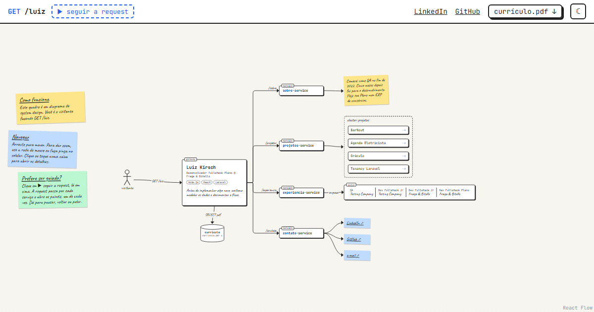
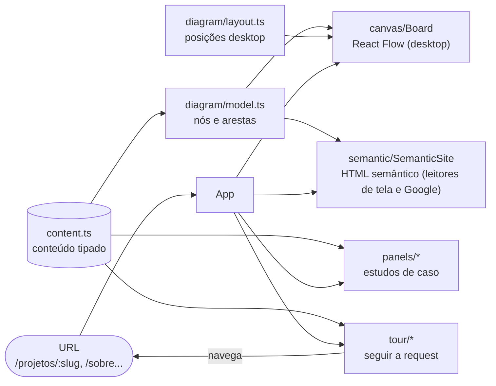

# Portfólio · Luiz Kirsch

Meu portfólio, desenhado como um quadro de system design. O visitante é um ator que faz `GET /luiz`, o gateway responde com quem eu sou, e as setas até os serviços são o menu.

**Site:** https://luizkirsch.github.io/portfolio/



## O conceito

Antes de escrever código, eu costumo desenhar o sistema. O site usa esse desenho como interface:

- **Gateway:** nome, cargo, stack principal e uma frase.
- **4 serviços:** `sobre-service`, `projetos-service`, `experiencia-service` e `contato-service`. Cada um liga a um tipo de nó: post-it, cluster de projetos, fila (a carreira em ordem) e links de contato.
- **Banco de dados "currículo":** baixa o PDF.
- **Painéis:** cada projeto abre um estudo de caso com diagrama, problema, decisões, papel e resultado. Cada painel tem a sua URL (`/projetos/barnout`, `/sobre` etc.).
- **Tour "seguir a request":** um ponto percorre as setas, a câmera para em cada nó e o painel daquela parada abre. Dá para pausar, voltar e pular.

Navegar é livre: arrastar, dar zoom, minimapa e "ver tudo". O celular usa o mesmo quadro, com pinça para zoom e toque nas caixas. Lá o minimapa some e os painéis abrem em tela cheia.

## Decisões técnicas

**React Flow para o canvas.** Pan, zoom, minimapa, nós focáveis e arestas entre handles já vêm prontos. Escrevi só o que é específico do quadro: os nós customizados (ator, gateway, serviço, cluster, projeto, fila, post-it e banco) e a câmera que segue a URL e o tour.

**Conteúdo tipado em um arquivo.** Todo o texto está em [`src/content/content.ts`](src/content/content.ts), com tipos (`Project`, `Experience`, `TourStep`...). Os componentes só leem dali. Um projeto novo é um objeto novo, e os testes reclamam se faltar campo.

**Modelo separado do layout.** [`diagram/model.ts`](src/diagram/model.ts) diz quais nós existem e como se ligam, sem nenhuma coordenada. [`diagram/layout.ts`](src/diagram/layout.ts) diz onde cada nó fica no quadro. A versão semântica percorre o mesmo modelo em ordem, então o quadro e o HTML não divergem sobre o que existe. O lado de saída de cada seta é calculado pela posição dos nós, e mover uma caixa não exige reconfigurar as setas.

**A URL é o estado.** Painel aberto é rota. Abrir `/projetos/barnout` direto centraliza o nó e abre o painel, e voltar do navegador funciona. O tour também navega: cada parada é uma rota.

**Versão semântica.** O canvas não é lido por leitor de tela, pelo Google nem pela prévia do LinkedIn. Por isso o mesmo conteúdo também é renderizado em HTML semântico (cabeçalhos, listas e links). Ela fica visualmente oculta e aparece como "versão em texto" se o foco do teclado chegar nela. Os mini diagramas dos painéis também têm descrição em texto. O canvas é navegável por teclado: Tab percorre os nós, Enter abre e Esc fecha.

**CSS Modules + variáveis CSS.** O modo escuro (uma lousa) troca só os tokens do `theme.css`. O React Flow é estilizado pelas variáveis dele, ligadas aos mesmos tokens.

**Tempo do tour pelo texto.** Parada que abre painel dura 4 s mais o tempo de leitura do painel (200 palavras por minuto). A barra de progresso é uma animação CSS, e o fim dela avança o tour. Pausar congela a animação e o tempo juntos. Com `prefers-reduced-motion`, o tour não avança sozinho.

## Arquitetura do site



```
src/
  content/content.ts     todo o conteúdo e os tipos
  diagram/model.ts       nós e arestas, derivados do conteúdo
  diagram/layout.ts      posições no desktop
  canvas/                Board (React Flow) e os nós customizados
  panels/                casca do painel, estudo de caso, mini diagramas
  semantic/              versão em HTML semântico
  tour/                  balão, ponto animado e tempo de cada parada
e2e/                     testes Playwright
scripts/og-image.mjs     gera a imagem de prévia (Open Graph)
```

## Como rodar

Precisa de Node 24.

```bash
npm ci
npm run dev        # http://localhost:5173
```

| Comando                              | O que faz                                             |
| ------------------------------------ | ----------------------------------------------------- |
| `npm run build`                      | typecheck + build de produção em `dist/`              |
| `npm test`                           | testes unitários (Vitest)                             |
| `npm run e2e`                        | build + testes end-to-end (Playwright)                |
| `npm run lint` / `npm run typecheck` | ESLint e TypeScript                                   |
| `npm run og`                         | gera de novo `public/og-image.png` a partir do quadro |

Na primeira vez, instale o navegador do Playwright: `npx playwright install chromium`.

## Testes

- **Unitários:** validam o `content.ts` (campos obrigatórios, slugs únicos, setas dos diagramas ligando nós que existem, nenhum `TODO` visível no texto, tour apontando para nós e painéis que existem), o encaixe entre modelo e layout, o tempo do tour e o painel de projeto.
- **E2E:** a página carrega com o gateway; cada projeto abre o painel certo e muda a URL; `/projetos/barnout` aberto direto; o tour completo e pulado no meio; o quadro no celular, com toque e painel em tela cheia; e os links de currículo, LinkedIn e GitHub visíveis, com o PDF servido de verdade.
- O GitHub Actions roda lint, typecheck, testes unitários, build e e2e a cada PR e a cada push na `main`.

## Adicionar um projeto

1. Acrescente um objeto em `projects`, no [`content.ts`](src/content/content.ts): `slug`, `title`, `summary`, ao menos um diagrama, `stack` e as seções do estudo de caso. Seção com lista vazia não aparece.
2. O diagrama do painel usa uma grade: cada nó tem `col` e `row`, e as setas ligam ids.
3. Prints (opcional) vão em `public/projetos/<slug>/` e entram em `images`.
4. Rode `npm test`.

O nó no cluster, a rota `/projetos/<slug>`, a parada no tour e o item na versão semântica saem do objeto. Não precisa mexer em layout nem em componente.

## Deploy

GitHub Pages, pelo próprio GitHub Actions: a cada push na `main`, depois que lint, testes e build passam, o job `deploy` publica o `dist/`.

- O site fica em `/portfolio/`. O workflow lê esse prefixo do `actions/configure-pages` e o passa como `BASE_PATH` (base do Vite e do React Router) e `SITE_URL` (URLs absolutas do Open Graph). Com outro nome de repositório ou domínio próprio, nada no código muda.
- O Pages não tem rewrite de SPA. O build gera um HTML por rota de painel ([`scripts/spa-routes.mjs`](scripts/spa-routes.mjs)): `/projetos/barnout` é servido por `projetos/barnout.html`, com status 200 e o título do projeto. URL inexistente cai no `404.html`, que volta para o início.
- Para ativar: em **Settings → Pages**, escolha **Source: GitHub Actions**.

## Stack

Vite, React 19, TypeScript, React Flow (`@xyflow/react`), React Router, Motion, CSS Modules, Vitest, Testing Library, Playwright e GitHub Actions.
